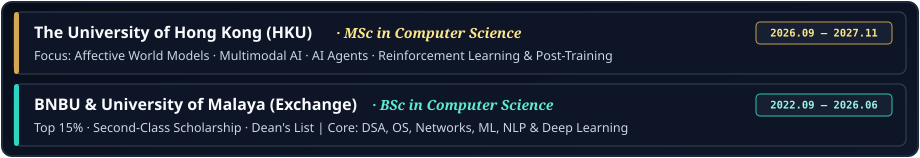
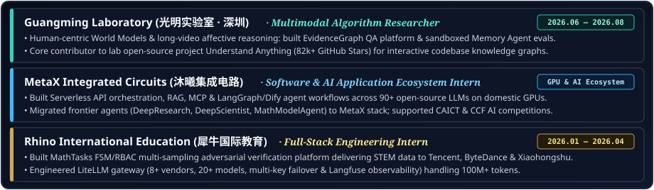
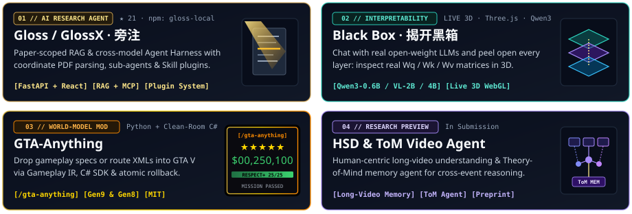

  
  
  
  
  

## 🎓 Education Background

## 💼 Internship Experience

## 💡 Professional Skills & Tech Stack

  

## 🤖 AI Coding Heavy User

## 🚀 Open Source & Geek Projects

  
    <b>QUICK ACCESS ↗</b> &nbsp;
    <a href="https://github.com/computersniper/gloss"><code>[01] Gloss / GlossX</code></a> (<a href="https://computersniper.github.io/gloss-site/">Site</a> · <a href="https://www.npmjs.com/package/gloss-local">npm</a>) ·
    <a href="https://github.com/computersniper/llm-blackbox"><code>[02] Black Box Repo</code></a> (<a href="https://caijiechao.com/blackbox/">Live 3D</a>) ·
    <a href="https://github.com/computersniper/GTA-Anything"><code>[03] GTA-Anything</code></a> ·
    <code>[04] HSD &amp; ToM Agent (Preprint Soon)</code>
  

- **Understand Anything (Contributor · 82k+ GitHub Stars)**: Contributed to Guangming Lab's open-source interactive knowledge-graph explorer for large codebases.
- **[Roles-Skill · 众生](https://github.com/computersniper/roles-skill)** & **[paste-cli](https://github.com/computersniper/paste)**: Designed a persona-distillation `AgentSkills` architecture with auto-dispatched Python tools, alongside a secret-safe one-command repo context packer (`pip install paste-cli`).
- **[Baipiao: Browser-Automation Local LLM Proxy](https://github.com/computersniper/baipiao)**: Built a local CDP browser-automation service (`Bun` / `Hono`) exposing standard OpenAI/Anthropic-compatible `/v1/chat/completions` endpoints.
- **[Multi-Agent AI Tutor](https://github.com/computersniper/ai-tutor)** & **[1024-D Embedding Space Game](https://github.com/computersniper/discover-embedding-space-game)**: Router-coordinated 4-agent teaching assistant for *Data Structures & Algorithms*, plus an interactive 1024-D `Qwen3-Embedding` concept navigation game.

## 🔬 Academic Research

- **Human-Centric Long-Video Understanding & Theory-of-Mind (ToM) Agents** *(In Submission)*: Researching multimodal long-video human state, belief, and affective reasoning with isolated sandbox memory evaluation, alongside controllable 3D facial expression synthesis (*Face Lab*), recursive self-improvement (*RSI*) verification loops, and MLLM face-privacy protection.
- **[IMU-Based In-Air Handwriting Recognition](https://github.com/computersniper/Android-IMU-Digits-Gesture-Dataset)**: Developed an Android 100 Hz 9-axis IMU data acquisition app (`Kotlin`) and a 5-layer `PyTorch` MLP achieving **98.67% accuracy** for XR interactions; open-sourced the 500-sample gesture dataset.
- **Tang Dynasty Official Documents NLP Analysis**: Applied `SIKU-BERT` high-dimensional contextual embeddings with `t-SNE`, `UMAP`, and clustering to uncover diachronic semantic drift across the An Lushan Rebellion.

<!-- jc-tech:start -->
<h2 align="center">🏢 My Virtual Company · JC Tech</h2>

  <a href="https://computersniper.github.io/jc-tech-website/">
    <picture>
      <source media="(prefers-reduced-motion: reduce)" srcset="./jc-tech/work.png" />
      
    </picture>
  </a>
   
  <a href="https://computersniper.github.io/jc-tech-website/"><b>Visit 3D Interactive Campus ↗</b></a> · Synced live with Beijing time (UTC+8)

<!-- jc-tech:end -->

  <picture>
    <source media="(prefers-color-scheme: dark)" srcset="https://raw.githubusercontent.com/computersniper/computersniper/output/github-contribution-grid-snake-dark.svg" />
    <source media="(prefers-color-scheme: light)" srcset="https://raw.githubusercontent.com/computersniper/computersniper/output/github-contribution-grid-snake.svg" />
    
  </picture>

