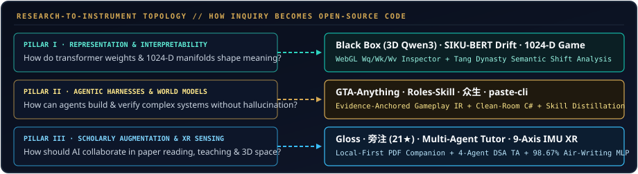

  
  
  
  
  

### 🏛️ Flagship Instruments · 代表作矩阵 (`纸页 · 权重 · 世界`)

  
    <b>DIRECT ACCESS ↗</b> &nbsp;
    <a href="https://github.com/computersniper/gloss"><code>[01] Gloss · 旁注</code></a> (<a href="https://www.npmjs.com/package/gloss-local">npm</a>) ·
    <a href="https://github.com/computersniper/llm-blackbox"><code>[02] Black Box · 揭开黑箱</code></a> (<a href="https://caijiechao.com/blackbox/">Live 3D</a>) ·
    <a href="https://github.com/computersniper/GTA-Anything"><code>[03] GTA-Anything (/gta-anything)</code></a>
  

### 🔭 Research-to-Instrument Topology · 从研究问题到开源系统

### 📄 Empirical Studies & Open Ecosystem

| Work | Domain | Highlights |
| :--- | :--- | :--- |
| **[9-Axis IMU Air-Writing XR](https://github.com/computersniper/Android-IMU-Digits-Gesture-Dataset)** | *HCI & Sensing* | 100 Hz Android 9-axis IMU acquisition (`Kotlin`) + 5-layer `PyTorch` MLP achieving **98.67% accuracy** on 3D in-air digit gestures; open-sourced 500-sample dataset |
| **Tang Dynasty Semantic Drift** | *Computational History* | High-dimensional diachronic analysis of official Tang documents via `SIKU-BERT` embeddings, UMAP/t-SNE manifold projection, and clustering across the An Lushan Rebellion |
| **[Multi-Agent AI Tutor](https://github.com/computersniper/ai-tutor)** | *AI in Education* | Central-router 4-agent teaching assistant for *Data Structures & Algorithms* with course-grounded debugging and integrity-aware practice generation |
| **[Roles-Skill · 众生](https://github.com/computersniper/roles-skill)** & **[paste-cli](https://github.com/computersniper/paste)** | *Agent Tooling* | Persona-distillation `AgentSkills` engine with auto-dispatched Python tools, alongside a secret-safe one-command codebase packer (`pip install paste-cli`) |
| **[1024-D Embedding Adventure](https://github.com/computersniper/discover-embedding-space-game)** | *Representation Space* | Interactive semantic navigation game powered by `Qwen3-Embedding-0.6B` cosine geometry |

<b>📖 展开页边旁注 · Margin Note — Toolchain &amp; AI-Native Workflow</b>

 

  

- **Education**: **The University of Hong Kong (HKU)** — *MSc in Computer Science* (`2026.09 – 2027.08`, LLMs, NLP & Multi-Agent Systems) · **BNBU & University of Malaya** *(Exchange)* — *BSc in Computer Science* (`2022.09 – 2026.06`, Top 15%, Second-Class Scholarship).
- **AI-Native Engineering**: Daily orchestration across `Claude Code`, `OpenAI Codex`, `Google Antigravity`, and `Cursor` — focusing on **Context Engineering**, **MCP**, and **Deterministic Agent Harnesses**.

<!-- jc-tech:start -->

  <a href="https://computersniper.github.io/jc-tech-website/">
    <picture>
      <source media="(prefers-reduced-motion: reduce)" srcset="./jc-tech/work.png" />
      
    </picture>
  </a>
   
  <b>JC Tech Virtual Lab</b> · Live scene synced to Asia/Shanghai (UTC+8)

<!-- jc-tech:end -->

  <picture>
    <source media="(prefers-color-scheme: dark)" srcset="https://raw.githubusercontent.com/computersniper/computersniper/output/github-contribution-grid-snake-dark.svg" />
    <source media="(prefers-color-scheme: light)" srcset="https://raw.githubusercontent.com/computersniper/computersniper/output/github-contribution-grid-snake.svg" />
    
  </picture>

