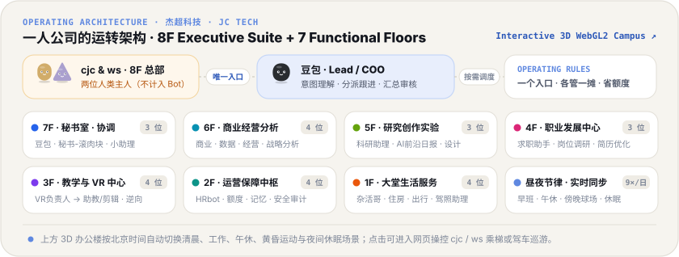
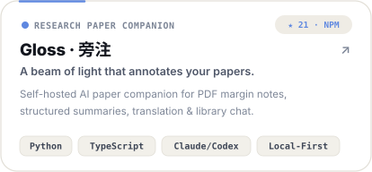
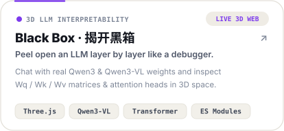
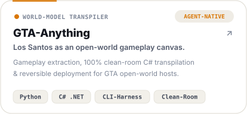
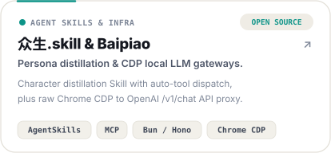
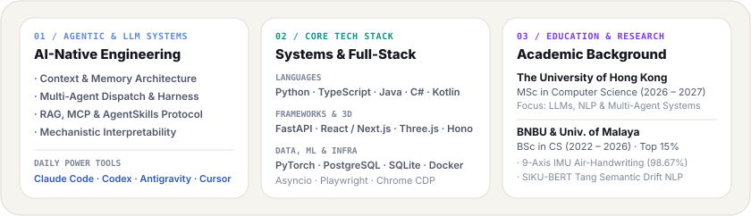

<a href="https://www.caijiechao.com">
  <picture>
    <source media="(prefers-color-scheme: dark)" srcset="./assets/hero-dark.svg" />
    
  </picture>
</a>

 

  <a href="https://computersniper.github.io/jc-tech-website/"><picture>
    <source media="(prefers-color-scheme: dark)" srcset="./assets/btn-jctech-dark.svg" />
    
  </picture></a>&nbsp;&nbsp;<a href="https://www.caijiechao.com"><picture>
    <source media="(prefers-color-scheme: dark)" srcset="./assets/btn-portfolio-dark.svg" />
    
  </picture></a>&nbsp;&nbsp;<a href="https://caijiechao.com/blackbox/"><picture>
    <source media="(prefers-color-scheme: dark)" srcset="./assets/btn-blackbox-dark.svg" />
    
  </picture></a>&nbsp;&nbsp;<a href="mailto:jiechaocai@gmail.com"><picture>
    <source media="(prefers-color-scheme: dark)" srcset="./assets/btn-email-dark.svg" />
    
  </picture></a>

 

  <picture>
    <source media="(prefers-color-scheme: dark)" srcset="./assets/sec-jctech-dark.svg" />
    
  </picture>

<!-- jc-tech:start -->

  <a href="https://computersniper.github.io/jc-tech-website/">
    <picture>
      <source media="(prefers-reduced-motion: reduce)" srcset="./jc-tech/lunch.png" />
      
    </picture>
  </a>

<!-- jc-tech:end -->

  <a href="https://computersniper.github.io/jc-tech-website/#architecture">
    <picture>
      <source media="(prefers-color-scheme: dark)" srcset="./assets/jctech-arch-dark.svg" />
      
    </picture>
  </a>

  

  <picture>
    <source media="(prefers-color-scheme: dark)" srcset="./assets/sec-works-dark.svg" />
    
  </picture>

  <a href="https://github.com/computersniper/gloss"><picture>
    <source media="(prefers-color-scheme: dark)" srcset="./assets/card-gloss-dark.svg" />
    
  </picture></a>&nbsp;<a href="https://github.com/computersniper/llm-blackbox"><picture>
    <source media="(prefers-color-scheme: dark)" srcset="./assets/card-blackbox-dark.svg" />
    
  </picture></a>

  <a href="https://github.com/computersniper/GTA-Anything"><picture>
    <source media="(prefers-color-scheme: dark)" srcset="./assets/card-gta-dark.svg" />
    
  </picture></a>&nbsp;<a href="https://github.com/computersniper/roles-skill"><picture>
    <source media="(prefers-color-scheme: dark)" srcset="./assets/card-agents-dark.svg" />
    
  </picture></a>

 

  <picture>
    <source media="(prefers-color-scheme: dark)" srcset="./assets/sec-stack-dark.svg" />
    
  </picture>
  <picture>
    <source media="(prefers-color-scheme: dark)" srcset="./assets/stack-bento-dark.svg" />
    
  </picture>

 

  <picture>
    <source media="(prefers-color-scheme: dark)" srcset="https://raw.githubusercontent.com/computersniper/computersniper/output/github-contribution-grid-snake-dark.svg" />
    <source media="(prefers-color-scheme: light)" srcset="https://raw.githubusercontent.com/computersniper/computersniper/output/github-contribution-grid-snake.svg" />
    
  </picture>

    
  <b>杰超科技 · JC Tech</b> &nbsp;·&nbsp; <i>"I build things for the world."</i> &nbsp;·&nbsp; <a href="https://www.caijiechao.com">caijiechao.com</a>

