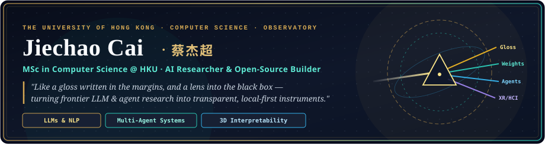
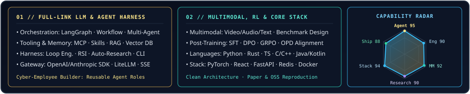
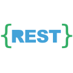
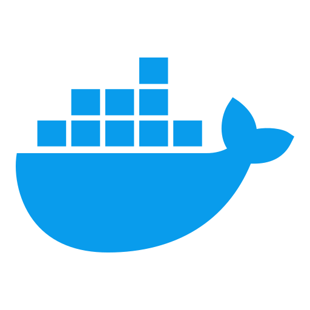
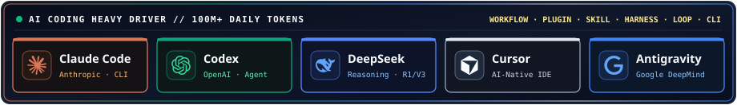
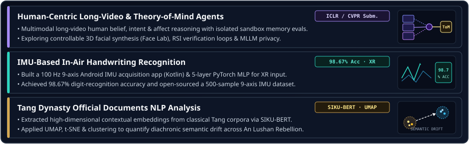

  
  
  
  
  

## 🎓 Education Background

## 💼 Internship Experience

## 💡 Professional Skills & Tech Stack

<table align="center">
  <tr>
    <td align="center" width="88"> Python</td>
    <td align="center" width="88"> Rust</td>
    <td align="center" width="88"> TypeScript</td>
    <td align="center" width="88"> JavaScript</td>
    <td align="center" width="88"> C / C++</td>
    <td align="center" width="88"> Java</td>
    <td align="center" width="88"> Kotlin</td>
    <td align="center" width="88"> C#</td>
    <td align="center" width="88"> React</td>
    <td align="center" width="88"> Next.js</td>
  </tr>
  <tr>
    <td align="center" width="88"> FastAPI</td>
    <td align="center" width="88"> Node.js</td>
    <td align="center" width="88"> REST / SSE</td>
    <td align="center" width="88"> PyTorch</td>
    <td align="center" width="88"> TensorFlow</td>
    <td align="center" width="88"> Redis</td>
    <td align="center" width="88"> PostgreSQL</td>
    <td align="center" width="88"> Docker</td>
    <td align="center" width="88"> Git</td>
    <td align="center" width="88"> GitHub</td>
  </tr>
</table>

## 🤖 AI Coding Heavy User

## 🚀 Open Source & Geek Projects

  
    <b>QUICK ACCESS ↗</b> &nbsp;
    <a href="https://github.com/computersniper/gloss"><code>[01] Gloss / GlossX</code></a> (<a href="https://computersniper.github.io/gloss-site/">Site</a> · <a href="https://www.npmjs.com/package/gloss-local">npm</a>) ·
    <a href="https://github.com/computersniper/llm-blackbox"><code>[02] Black Box Repo</code></a> (<a href="https://caijiechao.com/blackbox/">Live 3D</a>) ·
    <a href="https://github.com/computersniper/GTA-Anything"><code>[03] GTA-Anything</code></a> ·
    <code>[04] HSD &amp; ToM Agent (Preprint Soon)</code>
  

## 🔬 Academic Research

  
    <b>OPEN DATASET ↗</b> &nbsp;
    <a href="https://github.com/computersniper/Android-IMU-Digits-Gesture-Dataset"><code>Android-IMU-Digits-Gesture-Dataset (500 9-Axis 100Hz Gesture Samples)</code></a>
  

## 🏢 My Virtual Company

<!-- jc-tech:start -->

  <a href="https://computersniper.github.io/jc-tech-website/">
    <picture>
      <source media="(prefers-reduced-motion: reduce)" srcset="./jc-tech/evening.png" />
      
    </picture>
  </a>

<!-- jc-tech:end -->

  <picture>
    <source media="(prefers-color-scheme: dark)" srcset="https://raw.githubusercontent.com/computersniper/computersniper/output/github-contribution-grid-snake-dark.svg" />
    <source media="(prefers-color-scheme: light)" srcset="https://raw.githubusercontent.com/computersniper/computersniper/output/github-contribution-grid-snake.svg" />
    
  </picture>

